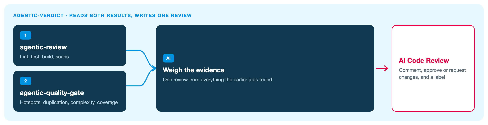

# agentic-verdict

The last step of a pull request. It reads the results from the two earlier jobs and posts one AI review: a comment, an approve or a request for changes, and a label.

It runs no scanners. The full picture of all four hubs is the [Agentic AppSec overview](https://github.com/pulumamidi-harsha/agentic-review#readme).

## What this repo does



| From | What it reads |
|:-----|:--------------|
| [agentic-review](https://github.com/pulumamidi-harsha/agentic-review#readme) | Did lint, test, build, and the security scans pass? |
| [agentic-quality-gate](https://github.com/pulumamidi-harsha/agentic-quality-gate#readme) | Hotspots, secrets, duplication, complexity, coverage |

The comment on the pull request is titled **AI Code Review**.

## Add it to an app

It is the third job. Copy [`examples/caller-orchestrated.yml`](examples/caller-orchestrated.yml):

```text
agentic-review  →  agentic-quality-gate  →  agentic-verdict
```

Secrets: `AI_API_KEY` and `AI_API_ENDPOINT`. Add `ORG_PAT` only if the hub repos are private.

Skip this job with the label `skip-ai-verdict` or `no-review`. Pin the workflow to a full commit SHA before production use.
