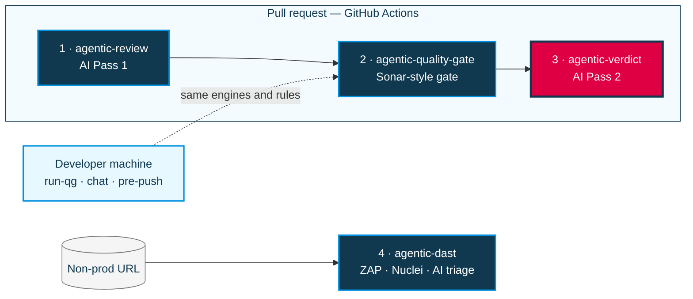

# agentic-verdict

**Job 3 — AI Pass 2 hub.** Final LLM review, `🤖 AI Code Review` PR comment, and labels.

Does **not** run lint, Semgrep, Docker, or DAST. It only **consumes artifacts** from earlier jobs and posts the verdict. Later, DAST reports from [agentic-dast](https://github.com/bayer-int/agentic-dast#readme) can feed the same Pass 2 step.

## Part of the Agentic AppSec platform

This repo is one of four hubs that together give Bayer teams agentic SAST and DAST checks: open-source scanners, with findings explained and prioritized by AI. For the problem statement, the full architecture diagram and the end-to-end PR flow, see **[Platform overview in agentic-review](https://github.com/bayer-int/agentic-review#platform-overview)**.



<sub>Highlighted in pink: this repo.</sub>

| # | Hub | Role |
|:-:|:----|:-----|
| 1 | [agentic-review](https://github.com/bayer-int/agentic-review#readme) | AI Pass 1: detects the stack, runs lint / test / build, dependency audit, secret and IaC scans |
| 2 | [agentic-quality-gate](https://github.com/bayer-int/agentic-quality-gate#readme) | Sonar-style gate: security hotspots, secrets, duplication, complexity, coverage. Also runs locally as `run-qg` |
| 3 | **agentic-verdict** (this repo) | AI Pass 2: weighs all evidence, posts the final PR review, approve / request changes, label |
| 4 | [agentic-dast](https://github.com/bayer-int/agentic-dast#readme) | Runtime scans of a live non-prod URL (OWASP ZAP + Nuclei) with AI triage into a sticky Issue |

---

## Where it sits in the PR pipeline

| Order | Hub | Workflow | Responsibility |
|------:|-----|-----|----------------|
| 1 | [`agentic-review`](https://github.com/bayer-int/agentic-review#readme) | `ai-review-phase1.yml` | Pass 1, lint/test checks, security; uploads `agentic-coverage` |
| 2 | [`agentic-quality-gate`](https://github.com/bayer-int/agentic-quality-gate#readme) | `quality-gate.yml` | Semgrep, duplication %, complexity, coverage % |
| 3 | **agentic-verdict** (this) | `ai-verdict.yml` | Pass 2 + PR comment/labels |

## Caller (all three in one workflow)

See [`examples/caller-orchestrated.yml`](examples/caller-orchestrated.yml).

```text
ai-phase1  →  quality-gate  →  ai-verdict
```

Pin every `uses:` / `pipeline_ref` to a **full SHA** before production.

## Secrets

- `AI_API_KEY`, `AI_API_ENDPOINT` (required)
- `ORG_PAT` (optional; clone private hubs)

## Skip labels

`skip-ai-review`, `skip-ai-verdict`, or `no-review`.
